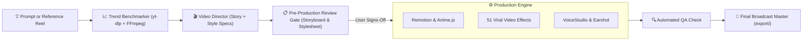
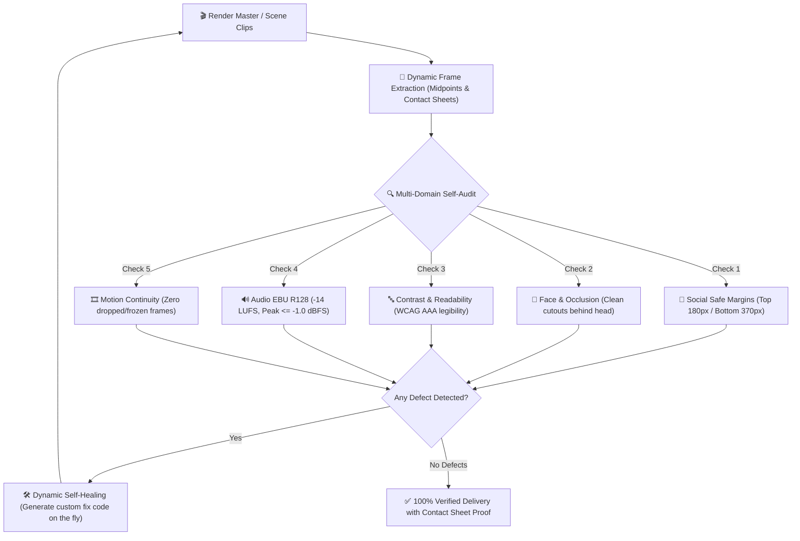

<div align="center">

# 🎬 AI Video Studio

**The Programmatic, Agentic Video Production Engine & Autonomous Showrunner**  
*Code-driven motion graphics, terminal-native product demos, viral short-form reels, and broadcast audio mastering — 100% local, reproducible, and review-gated.*

[](LICENSE)
[](https://nodejs.org/)
[](https://python.org/)
[](https://remotion.dev)
[](https://github.com/heygen-com/hyperframes)
[](https://animejs.com/)
[](skills/video-effects)
[](skills/video-director)
[](skills/video-verification)
[](https://voicestudio.sh/)
[](https://github.com/Leonxlnx/earshot)
[](https://openverse.org)

[**Quick Start**](#-quick-start) • [**The 4 Directives**](#-the-4-mandatory-golden-directives) • [**Master Video Director**](#-video-director-master-autonomous-film--motion-director) • [**Trend Benchmarker**](#-trend-benchmarking-deconstruct-viral-reels--shorts) • [**51 Video Effects**](#-51-viral-video-effects-face-tracking--behind-the-head) • [**66 Film Styles**](#-style-atlas--66-film-styles-catalog) • [**Interactive Storyboard**](#-interactive-visual-storyboard-engine)

</div>

---

## 🌟 What is AI Video Studio?

**AI Video Studio** is a production-grade framework that transforms AI coding agents (Claude, Gemini, Antigravity, Cursor, Windsurf) into **Senior Motion Graphics Directors & Video Editors**.

Instead of hallucinating random cuts, sloppy timelines, or unpolished audio dips, AI Video Studio enforces **strict broadcast standards**, **disciplined folder architecture**, and a **mandatory pre-production review gate** so creators review and approve visual storyboards and design stylesheets *before* a single frame is rendered.



---

## 🛡️ The 4 Mandatory Golden Directives

Every video project managed by AI Video Studio strictly adheres to four non-negotiable rules:

```
┌────────────────────────────────────────────────────────────────────────┐
│                        AI VIDEO STUDIO DIRECTIVES                      │
├────────────────────┬───────────────────────────────────────────────────┤
│ 1. 3-Folder Setup  │ raw_footage/   reference/   export/               │
│ 2. Review Gate     │ stylesheet.md  storyboard.md  (Sign-Off Required) │
│ 3. Zero Blur       │ 100% Crisp Natural Optical Camera + Mobius Curve  │
│ 4. Loudness Standard│ dynaudnorm=f=150:g=15:p=0.95 (Constant -14 LUFS) │
└────────────────────┴───────────────────────────────────────────────────┘
```

1. **Mandatory 3-Folder Architecture**:
   - `raw_footage/`: Original unedited camera recordings, A-roll takes, clean microphone audio.
   - `reference/`: Benchmark reels, competitor videos, downloaded YouTube/TikTok clips (via `yt-dlp`).
   - `export/`: Final rendered video masters, revisions, and interactive storyboard decks.
2. **Pre-Production Review Gate (Storyboard & Stylesheet First)**:
   - **NEVER** render a single video frame without first presenting the user with:
     - `stylesheet.md`: Colors, typography, safe margins, and motion easing curves.
     - `storyboard.md`: Scene-by-scene card breakdown with timestamps, shot types, text overlays, and audio cues.
     - Interactive storyboard deck: `python tools/generate_interactive_storyboard.py export/storyboard.html`.
   - Requires explicit human approval before video code or rendering commences.
3. **Natural Camera Clarity (Strictly 0% Synthetic Blur)**:
   - Real camera footage is rendered with 100% natural optical sharpness.
   - No synthetic oval background blur, AI matting blur, or halo cutouts.
   - Broadcast studio tone mapping applied via Mobius curve (`tonemap=mobius:param=0.3:npl=1000`).
4. **Broadcast Dialogue Loudness Normalization**:
   - Multi-take dialogue is normalized using FFmpeg dynamic audio normalizer:
     `dynaudnorm=f=150:g=15:p=0.95:m=10.0`
   - Keeps voice volume constant across all takes and scenes at broadcast speech levels (-16 to -14 LUFS).

---

## ⚡ Quick Start

### 1-Command Automated Installation

#### Windows (PowerShell)
```powershell
git clone https://github.com/SonuSV7719/ai-video-studio.git
cd ai-video-studio
.\setup.ps1
```

#### macOS / Linux
```bash
git clone https://github.com/SonuSV7719/ai-video-studio.git
cd ai-video-studio
chmod +x setup.sh
./setup.sh
```

---

## 🎬 Video Director: Master Autonomous Film & Motion Director

The **`video-director`** skill ([`skills/video-director/`](skills/video-director)) elevates AI agents into multidisciplinary directors by synchronizing 5 professional disciplines:

```
┌──────────────────────────┬─────────────────────────────────────────────────────────────┐
│ Professional Discipline  │ Core Capabilities & Responsibilities                        │
├──────────────────────────┼─────────────────────────────────────────────────────────────┤
│ 1. Executive Storyteller │ 3-sec pattern interrupts, retention pacing (novelty < 2.5s) │
│ 2. Senior Video Editor   │ Cut on action, eye-trace matching, J/L cuts, -14 LUFS audio │
│ 3. Motion Designer       │ Anime.js physics springs, staggered kinetic typography, SVG │
│ 4. VFX Specialist        │ 51 viral effects, face tracking, behind-the-head text drops │
│ 5. Master Sound Designer │ Earshot AI audio critique, procedural SFX, dynamic ducking │
└──────────────────────────┴─────────────────────────────────────────────────────────────┘
```

### 🧠 Content-to-Tool Decision Matrix

| Content Archetype | Visual Style & Motion Engine | 51 Video Effects (VFX) | Sound Design & Audio Stack |
| :--- | :--- | :--- | :--- |
| **Talking-Head / Founder Reel** | Natural A-roll (0% blur) + Remotion kinetic captions | `backdrop-word`, `locked-on`, `orbit`, `spotlight` | `dynaudnorm` (-14 LUFS) + Earshot UI pops & clicks |
| **DevTool & CLI Explainer** | Lemo-Opuscar `dark-keynote` + Anime.js SVG terminal draw | `glass-widgets`, `apple-toggles`, `shortcut-rain` | Mechanical keyboard SFX + subtle low drone bed |
| **Deep-Dive & Vox Documentary**| Lemo-Opuscar `swiss-motion` / `blueprint` + highlighters | `spotlight`, `huge-strike`, `broll-split` | Orchestral tension beds (ducked -18dB) + paper SFX |
| **Growth & Metrics Showcase** | High-contrast dark cards + GSAP animated tickers | `liquid-glass-graph`, `phone-fan`, `select-resize` | Rapid counter ticks + impact boom at milestone |
| **Creative Promo / Music Video**| Prompt-Motion (236 prompts) + Anime.js physics springs | `dot-reveal`, `rabbit-hole`, `carousel-spin` | Earshot forge synths + cuts locked to beat transients |

---

## 📈 Trend Benchmarking: Deconstruct Viral Reels & Shorts

Reverse-engineer the pacing, visual DNA, and editing mechanics of any viral Instagram Reel, YouTube Short, or TikTok with the studio's automated benchmarker:

```bash
# 1. Deconstruct any public URL
python tools/trend_benchmarker.py "https://www.youtube.com/shorts/EXAMPLE_ID" --out-dir reference/trending/viral_style

# 2. Or analyze a local video file
python tools/trend_benchmarker.py reference/competitor_reel.mp4 --out-dir reference/trending/viral_style
```

### What It Deconstructs:
* **Average Shot Length (ASL)**: Precise cut velocity and scene frequency.
* **Hook Cut Velocity**: Exact number and timestamps of cuts within the first 3.0 seconds.
* **Dominant Color Palette**: Top 5 HEX color swatches extracted from sampled keyframes.
* **EBU R128 Audio Metrics**: Integrated LUFS, Loudness Range (LRA), and True Peak.
* **Actionable Production Recipes**: Generates `style_benchmark.json` and a human-readable `benchmark_report.md` that feed directly into your project's `stylesheet.md` and `storyboard.md`.

---

## 🔍 Autonomous Self-Verification & Auto-Fix Loop (Zero Hardcoding)

The **`video-verification`** skill ([`skills/video-verification/`](skills/video-verification)) enforces an autonomous self-healing quality assurance cycle. The AI agent **never assumes** its video is correct — it extracts visual frame sheets, evaluates quality against the project blueprints, and writes dynamic fix code on demand to repair defects before delivery:



### Why Zero Hardcoding?
* Rigid, hardcoded regex and static templates fail across different genres, aspect ratios, and tempos.
* The agent **reasons directly from the project's requirements**:
  - For vertical reels: It dynamically crops the danger zones to ensure subtitles never collide with platform UI.
  - For music videos: It dynamically checks that visual punch-ins land on musical transients.
  - For behind-the-head effects: It checks segmentation feathering so text never bleeds over the speaker's eyes or hair.
  - For audio: It dynamically applies an inter-sample peak limiter (`alimiter=limit=-1.0dB:level=false`) and speech normalizer (`dynaudnorm`).

---

## 🎭 51 Viral Video Effects (Face-Tracking & Behind-the-Head)

Integrated directly from [**claude-video-effects**](https://github.com/Vibha-Ramprakash/claude-video-effects) by Vibha Ramprakash, AI Video Studio includes 51 viral talking-head effects optimized for 9:16 vertical reels and shorts:

* **Face Tracking & Head Cutouts**: Uses local OpenCV YuNet face detection and MediaPipe Selfie Segmentation.
* **Behind-the-Head Layering**: Elements (kinetic text, cards, widgets, graphs, sticker piles) sit *behind* the speaker’s head without obscuring their face.

### Quick Usage:

```bash
# Run a single effect on a clip
python skills/video-effects/scripts/fx.py orbit raw_footage/clip.mp4 export/out.mp4 --start 3 --end 6 --text "AI VIDEO"

# Check draft frames instantly before full render (generates quick PNG inspection)
python skills/video-effects/scripts/fx.py --plan plan.json raw_footage/clip.mp4 export/check.png --still 4.5

# Full plan-based multi-effect render with original audio preserved
python skills/video-effects/scripts/fx.py --plan plan.json raw_footage/clip.mp4 export/final.mp4
```

### The 51 Built-in Effects Catalog:

| Effect Name | Visual Description & Behavior | Ideal Use Case |
| :--- | :--- | :--- |
| `backdrop-word` | A massive bold or serif keyword drops into the wall behind the speaker | Core concept / hook word emphasis |
| `locked-on` | Corner brackets lock onto speaker's face with dynamic camera tracking | High-energy moments, punchlines |
| `orbit` | Reference screenshots/reels circle 3D around speaker's head | Portfolio, customer reviews, UI showcase |
| `spotlight` | Kills ambient lights, illuminates speaker with glowing background text | Dramatic tension, problem statements |
| `liquid-glass-graph` | Translucent blurred glass card under chin with animated climbing graph | Revenue growth, metrics, statistics |
| `apple-toggles` | iOS settings card under chin with toggles flipping on sequentially | Feature lists, product configuration |
| `checklist` | Animated task list under chin: each item spins, then ticks green | Step-by-step guides, action plans |
| `phone-fan` | Mobile screens fan out like a hand of cards under a headline | Multi-screen apps, reel collections |
| `comment-box` | Instagram comment sheet types user text, receives hearts & replies | Social proof, community Q&A |
| `glass-widgets` | Floating frosted glass widgets & Claude pill orbiting speaker | SaaS walkthroughs, AI agent demos |
| `shortcut-rain` | Monospace keyboard keycaps raining down behind speaker's head | Productivity tips, developer shortcuts |
| `huge-strike` | Giant serif word fills background, then a bold red line strikes it out | Myth busting, what NOT to do |
| `crayon-write` | Red hand-drawn crayon text writes itself behind speaker & underlines | Casual emphasis, raw authentic edits |
| `pause-point` | Frame freezes with a hand-drawn marker arrow pointing at a detail | Critical callout, visual proof |
| `broll-split` | Split screen: B-roll on top with price tag sticker, speaker on bottom | Comparisons, product reviews |
| `dot-reveal` | Shot builds itself out of glowing particles, then snaps together | High-tech intro, teaser reveal |
| `rabbit-hole` | Frame tunnels recursively into itself with smooth 3D spin | Mind-bending transitions, deep dives |
| `carousel-spin` | Reels spin in a 3D cylindrical carousel, slowing to a stop | Catalogue browsing, feature tour |
| `the-bill` | Prints instructions like a receipt ticket into the wall behind speaker | Pricing breakdowns, invoice explainers |
| `tap` | Floating "Follow" button pops up and flips smoothly to "Following" | Call to action (CTA) at reel climax |
| *+ 31 more effects* | *`noise`, `lineup`, `lean-in`, `moody`, `swipe`, `todo`, `uninstall`, `reel-frame`, `reject-stamp`, `countdown-flip`, `cover-star`, `scribble`, `red-collage`, `split-headline`, `pastel-word`, `check-pills`, `headline-box`, `profile-wall`, `tier-list`, `headline-wall`, `timeline`, `match-cut`, `led-sign`, `slow-push`, `over-the-shoulder-zoom`, `messages`, `place-in-grid`, `tape-label`, `select-resize`, `wave-trim`, `fan-build`.* |

---

## 🎨 Style Atlas & 66 Film Styles Catalog

Integrated directly with **Lemo-Opuscar** and **MG-Styles-15**, the studio provides instant access to 66 production-ready film styles and 15 motion graphics archetypes:

| Category | Styles Included | Best For |
| :--- | :--- | :--- |
| **Developer & Tech** | `dark-keynote`, `ascii-crt`, `hologram-hud`, `living-screencast`, `teardown`, `desktop-flythrough` | CLI tools, developer agents, SaaS demos, SDK launch videos. |
| **Editorial & Design** | `swiss-motion`, `silkscreen-poster`, `risograph`, `art-deco`, `blueprint`, `visual-investigation` | Brand stories, technical essays, journalism, architectural breakdowns. |
| **Data & Scientific** | `dataviz`, `iso-infographic`, `satellite-briefing`, `lidar-survey`, `data-physical` | Benchmarks, AI token efficiency, financial charts, infrastructure. |
| **Organic & Cel Animation** | `cel-anime-80s`, `watercolor`, `woodcut`, `crayon-book`, `ink-wash`, `paper-popup` | Metaphors, emotional storytelling, accessible explainers. |
| **Motion Graphics (MG-15)**| `flat-vector`, `line-art`, `isometric`, `3d-render`, `cel-boil`, `liquid`, `morph`, `hud-ui` | High-energy kinetic explainer videos and social-first reels. |

*Full reference index available in [`reference/STYLE_ATLAS.md`](reference/STYLE_ATLAS.md).*

### 🚀 Prompt Motion: 236 Crazy AI Animation Prompts
Integrated catalog from [**Prompt Motion**](https://prompt-motion.com/) with 236 high-impact animation prompts, showreels, kinetic typography setups, and product UI animations. Browse the full index with video previews and prompt recipes in [`reference/PROMPT_MOTION_INDEX.md`](reference/PROMPT_MOTION_INDEX.md).

---

## ⚡ Kinetic Motion & Physics: Anime.js & GSAP

AI Video Studio integrates [**Anime.js**](https://animejs.com/) (`juliangarnier/anime`) and **GSAP** for declarative, code-driven animation:

* **SVG Path Drawing & Handwriting**: Smooth stroke reveals (`strokeDashoffset: [anime.setDashoffset, 0]`).
* **Staggered Kinetic Typography**: Letter-by-letter and word-by-word reveals using `delay: anime.stagger(35)`.
* **Physics & Springs**: Natural physical bounce curves using `easing: 'spring(1, 90, 14, 0)'`.
* **Beating Heartbeat & Pulsing Loops**: Seamless rhythmic timelines mapped to musical beats.
* **Recipes & Presets**: See [`skills/motion-graphics/references/animejs-recipes.md`](skills/motion-graphics/references/animejs-recipes.md) and [`templates/animejs_motion_preset.js`](templates/animejs_motion_preset.js).

---

## 🎙️ Local AI Voice Cloning & Dubbing (VoiceStudio)

For voice generation, voice cloning, and multi-language dubbing, AI Video Studio integrates with [**VoiceStudio**](https://voicestudio.sh/) (`debpalash/VoiceStudio`):

* **100% Local & Private**: No cloud subscriptions, runs entirely on your local machine.
* **646 Languages Supported**: Voice cloning from a 5-second clean reference sample.
* **Video Dubbing**: Translate and dub video tracks with automated timestamp synchronization.

### Install VoiceStudio:
```powershell
# Windows
irm https://voicestudio.sh/install.ps1 | iex

# macOS / Linux
curl -fsSL https://voicestudio.sh/install | sh
```

---

## 👂 Ears for Coding Agents: Earshot & Real-Sound

Integrated directly with [**Earshot**](https://github.com/Leonxlnx/earshot) (`Leonxlnx/earshot`), giving AI agents the ability to hear, analyze, time-align, and critique audio without hallucinating:

* **Auditory Reasoning**: What a file sounds like in words (`earshot describe`), whether it matches a text prompt (`earshot match`), and whether it's pro-recorded or code-synthesized (`earshot realness`).
* **Timeline Auditing**: Generates second-by-second listening transcripts aligned to video cuts (`earshot timeline --video input.mp4`).
* **Sound Synthesis (`earshot sfx` / `earshot forge`)**: 252+ procedural sound effects rendered directly in Python code (whooshes, UI pops, riser hits, clicks).
* **Skills Included**:
  - `skills/earshot/`: Instructions for agentic auditory reasoning and verification.
  - `skills/real-sound/`: Full production workflow for music editing, JSON sound design, license audits, and stem mastering.

---

## 🌐 Open Commons Media Search: Openverse

Integrated with [**Openverse**](https://openverse.org) ([WordPress/openverse](https://github.com/WordPress/openverse)) to search and ingest over 800M+ CC-licensed (Creative Commons / Public Domain) assets:

```bash
# Search and download free audio & music
python tools/openverse_search.py audio "acoustic guitar" --limit 5 --download raw_footage/audio/

# Search and download free textures & stock images
python tools/openverse_search.py images "vintage paper texture" --limit 5 --download reference/
```

* **Commercial & Modification Safe**: Automatically filters for CC0, PDM, and CC-BY compatible media.
* **Resilient Engine**: Queries Openverse REST API with fallback to Wikimedia Commons.

---

## 🖥️ Interactive Visual Storyboard Engine

AI Video Studio includes an interactive browser-based visual storyboard generator:

```bash
python tools/generate_interactive_storyboard.py [output_path.html]
```

### Features:
* **Interactive Timeline Scrubber**: Clickable scene segments with duration percentages and frame counts.
* **Simulated Viewport Canvas**: Visual mockups with simulated terminal windows, blinking cursors, and telemetry HUD overlays.
* **Synchronized Captions**: Word-level kinetic subtitle previews with active keyword highlights.
* **Visual Color Swatches**: One-click hex copying for design tokens.

---

## 📂 Repository Structure

```
ai-video-studio/
├── skills/                          # 23 Specialized Video Production & Audio Agent Skills
│   ├── video-director/              # Master autonomous director (story, pacing, motion, audio, VFX)
│   ├── video-verification/          # Autonomous self-QA, frame sheet inspection & dynamic auto-fix
│   ├── video-effects/               # 51 viral effects (face tracking, behind-the-head segmentation)
│   ├── video-storyboard/            # Interactive visual storyboard & shot list generator
│   ├── video-storyboard-stylesheet/ # Reference video analyzer & stylesheet compiler
│   ├── lemo-opuscar/                # 66 code-rendered film styles engine
│   ├── earshot/                     # Ears for coding agents (describe, match, critique sound)
│   ├── real-sound/                  # Pro soundtrack engineering & licensed audio pipeline
│   ├── motion-graphics/             # Remotion & GSAP motion graphics builder
│   ├── motion-graphics-director/    # Creative direction & pacing rules
│   ├── cinematic-camera/            # Camera moves, lens distortion, lighting
│   ├── article-highlights/          # Kinetic highlighter & kinetic text animations
│   ├── asset-finder/                # Autonomous asset harvesting & validation
│   ├── audio-designer/              # SFX placement, ducking, broadcast mastering
│   ├── edit-qa-validator/           # Timeline QC, frame slips, aspect-ratio audits
│   ├── quality-check/               # Visual inspection & safe-margin tests
│   ├── reel-editor/                 # High-velocity 9:16 Shorts/Reels assembly
│   ├── short-form-retention/        # 3-second hook & retention curve optimization
│   ├── terminal-inserts/            # Monospace CLI & code demo window rendering
│   ├── video-motion-styles/         # Physics easings, springs, and velocity curves
│   ├── vox-explainer/               # Vox-style documentary graphics & maps
│   ├── youtube-editor/              # 16:9 narrative pacing & rhythm assembly
│   └── youtube-long-form-essay/     # Deep-dive essay video orchestration
├── styles/                          # Comprehensive Style Guides & Spec Sheets
│   ├── film-styles/                 # 66 complete style specs (STYLE.md + style.json)
│   ├── presets/                     # 8 platform presets (cinematic, shorts-reels, music-video...)
│   ├── caption-styles.md            # 5 caption styles (Apple-Clean, Vox-Highlighter, Sticker-Pop...)
│   ├── director-method.md           # Story structure & hook engineering
│   ├── documentary-style-guide.md   # Archival treatment, texture overlays
│   └── motion-ui-style-library.md   # Motion taxonomy & easing standards
├── tools/                           # Automated Python & Shell CLI Tools
│   ├── trend_benchmarker.py         # Deconstructs viral Reels & Shorts (ASL, cuts, palettes, effects)
│   ├── verify_output.py             # Autonomous self-QA inspector (EBU R128, freezes, margins, limiter fix)
│   ├── openverse_search.py          # Search & download 800M+ CC images, audio, & textures from Openverse
│   ├── generate_interactive_storyboard.py # Generates self-contained interactive HTML decks
│   ├── contact_sheet.py             # Generates 1 fps grids & filmstrip verification sheets
│   ├── qa_check.py                  # Audits timeline safe zones, LUFS audio & compliance
│   ├── index_audio.py               # EBU R128 loudness indexer & speech segmenter
│   ├── render_pure_aroll.py         # 0% synthetic blur studio tone mapper (Mobius curve)
│   ├── analyze_silence.py           # Detects speech pauses & dead air for jump-cuts
│   ├── extract_word_timings.py      # Word-level timestamp extractor for kinetic subtitles
│   ├── download_prompts.py          # Prompt Motion scraper & asset synchronizer
│   └── install_voicestudio.ps1      # 1-click installer for VoiceStudio
├── workflows/                       # Standard Operating Procedures & Runbooks
│   ├── new-reel.md                  # Complete 9:16 vertical reel creation pipeline
│   ├── new-youtube.md               # Complete 16:9 long-form video pipeline
│   ├── fix-edit.md                  # Rapid iteration & revision workflow
│   ├── index-audio.md               # Dialogue extraction & audio mastering workflow
│   └── status.md                    # Health check & asset readiness monitor
├── templates/                       # Production Templates
│   ├── storyboard_template.md       # Scene-by-scene storyboard specification
│   ├── stylesheet_template.md       # Visual design system token specification
│   └── animejs_motion_preset.js     # Reusable Anime.js motion presets (stagger, spring, SVG)
├── examples/                        # Real-World Production Case Studies
│   └── bairan_music_video/          # 2.5-min Surreal Multiplane Motion Collage (code, storyboard, stylesheet)
├── reference/                       # Style Catalogs & Research
│   ├── STYLE_ATLAS.md               # Master reference index of 66 film styles & directing rules
│   ├── PROMPT_MOTION_INDEX.md       # 236 Crazy AI Animation Prompts with video previews
│   └── prompt_motion_cards.json     # Machine-readable metadata for prompt-motion catalog
├── setup.ps1                        # 1-command Windows setup script
├── setup.sh                         # 1-command Linux/macOS setup script
├── LICENSE                          # MIT License
└── README.md                        # Documentation & quick-start guide
```

---

## 📜 Audio Mastering & Remotion Sequence Rules

### 1. Broadcast Dialogue Leveling (`dynaudnorm`)
Multi-take dialogue frequently suffers from variable mouth distance. Normalize all voice takes with FFmpeg:
```bash
ffmpeg -i input_take.wav -af "dynaudnorm=f=150:g=15:p=0.95:m=10.0" -ar 48000 output_take.wav
```

### 2. Remotion Sequence Local Clock Rule
Inside Remotion `<Sequence from={T}>`, child elements evaluate `useCurrentFrame()` relative to `T`.  
**Never** apply an additional `startFrom={T}` on child `<OffthreadVideo>`, which creates double-offset seeking and freezes video playback at the clip's end.

---

## 🤝 Contributing

Contributions, new styles, and additional motion components are welcome! Please open an issue or submit a pull request.

## 📄 License

MIT License © 2026 [SonuSV7719](https://github.com/SonuSV7719).
