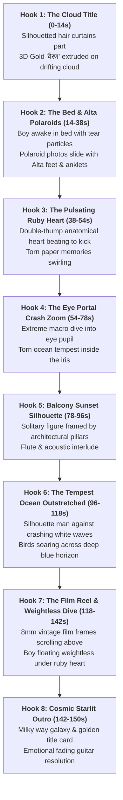

# Executive Storyboard: Bairan Surreal Multiplane Motion Collage

**Song**: Bairan — Banjaare  
**Duration**: 02:30.39 (150.4s | 3,610 frames @ 24fps)  
**Style Benchmark**: Surreal Multiplane Motion Collage (Authentic to Bairan Official Visual Language)  
**Target Master**: `export/bairan_music_video_master.mp4`

---

## Narrative & Hook Architecture

---

## Detailed Scene-by-Scene Breakdown

### Scene 1: The Cloud Portal & Title Hook (00:00.00 – 00:14.00 | Frames 0 – 336)
* **Visual Hook**: Two flowing dark curly hair cutouts frame the left and right borders like velvet stage curtains. As acoustic guitar strums begin, the hair curtains part outward with spring physics.
* **Center Subject**: A fluffy white dimensional cloud drifts across a pastel blue sky. Upon the cloud rests the 3D extruded golden title:
  - Top: `"बैरण"` (Devanagari gold leaf with deep cast shadow)
  - Bottom: `"بیرن"` (Urdu script calligraphy)
* **Motion Graphics**:
  - Horizontal cloud drift (`vx = +12px/s`).
  - Subtle lens flare streaks and floating golden dust sparkles.
* **Audio Cue**: Opening acoustic fingerpicking & ambient morning breeze.
* **Typography**: `"BANJAARE PRESENTS"` -> `"बैरण • BAIRAN"`

---

### Scene 2: The Bed & Alta Feet Polaroids (00:14.00 – 00:38.00 | Frames 336 – 912)
* **Visual Hook**: Top-down cinematic angle on a young man lying awake in bed, head upon a white pillow. A luminous tear rolls down his cheek, emitting glowing violet particle motes.
* **Layered Cutouts**:
  - Sliding Polaroid photographs flutter into the frame at slight rotations (`-8°` to `+12°`) with deep drop shadows.
  - Polaroids depict a woman's feet adorned with traditional bright red Alta dye and golden payal (anklets) resting on vintage sheet music and galaxy starfields.
* **Motion Graphics**:
  - Payal bells vibrate slightly on the dholak kick hits.
  - Floating purple tear dust (`tear-violet` `#8A5CF6`) drifts upward toward the ceiling.
* **Kinetic Lyric Overlay**:
  - Line 1: `"बैरी तन्हाई मनै"` (00:14 – 00:26)
  - Line 2: `"तेरे झांझरा के जोड़े"` (00:26 – 00:38)
  - Styling: Golden illuminated text with dark amber drop shadow.

---

### Scene 3: The Pulsating Ruby Heart (00:38.00 – 00:54.00 | Frames 912 – 1296)
* **Visual Hook**: A glistening 3D anatomical glass/ruby heart floats in the center against a soft warm studio backdrop.
* **Motion Graphics**:
  - **Double-Thump Heartbeat**: Synchronized to the rhythm at 92 BPM (`scale = 1.0 -> 1.15 -> 1.0` with rhythmic bounce).
  - Floating torn-paper memory photos spin gently around the heart like orbital satellites.
  - Subtle internal light caustics and red glow pulses.
* **Kinetic Lyric Overlay**:
  - `"छाती के लगाई मनै..."`
* **Audio Cue**: Percussion swells, guitar strumming intensifies, dholak bass thumps.

---

### Scene 4: The Eye Portal & Crash Zoom Climax (00:54.00 – 01:18.00 | Frames 1296 – 1872)
* **Visual Hook**: Extreme macro close-up of a golden/hazel human eye with individual eyelashes in razor-sharp detail.
* **The Portal Zoom**:
  - Camera initiates an exponential crash zoom (`expo.inOut`) directly into the pupil.
  - Inside the black pupil, a torn paper boundary parts, revealing a stormy ocean horizon with the glowing ruby heart beating amidst sea spray.
* **Motion Graphics**:
  - Pupil dilation and expansion (`scale 1.0 -> 7.5x`).
  - Multiplane torn paper edges peeling backward in 3D perspective.
* **Kinetic Lyric Overlay**:
  - `"हाय रे बैरण... हाय रे बैरण..."` (Chorus 1 Hook drop pulsing in rhythm).

---

### Scene 5: The Balcony Sunset Silhouette (01:18.00 – 01:36.00 | Frames 1872 – 2304)
* **Visual Hook**: Looking through dark architectural structural pillars from a high terrace. In the center stands a solitary dark silhouette looking out at a painted terracotta and crimson sunset orb over layered mountain ridges.
* **Motion Graphics**:
  - 3D parallax drift: Pillars move faster in foreground than the distant sun and mountains.
  - The sun radiates an animated warm chromatic bloom pulse.
* **Audio Cue**: Flute and solo acoustic guitar melodic interlude.
* **Kinetic Lyric Overlay**:
  - `"जीणा बंजारे का..."`

---

### Scene 6: The Tempest Ocean & Outstretched Soul (01:36.00 – 01:58.00 | Frames 2304 – 2832)
* **Visual Hook**: Epic wide shot of a deep moody blue sea (`deep-ocean` `#142236`). On a rocky crag in the foreground stands a solitary man with long coat, arms outstretched toward the vast horizon holding a wand/flute.
* **Motion Graphics**:
  - Animated crashing white foam waves churning against the shore.
  - Silhouetted seagulls gliding across the overcast sky.
  - Camera slowly elevates from low to high angle.
* **Kinetic Lyric Overlay**:
  - `"जित भी गया रै तेरी... ठीक कोन्या हाल मेरा"`

---

### Scene 7: Vintage 8mm Film Reel & Falling Weightless (01:58.00 – 02:22.00 | Frames 2832 – 3408)
* **Visual Hook**: Split-composition surrealism:
  - Top: A vintage 8mm film strip with sprocket holes rolls horizontally, projecting motion-blurred memories of her eyes and smile.
  - Bottom: The boy floats weightlessly in deep blue liquid/space, hair suspended, looking upward at the glowing red heart hovering above his chest.
  - Foreground Right: The crying girl's profile with single glistening tear observing the scene.
* **Motion Graphics**:
  - Continuous vertical floating bob (`sin(t * 1.5) * 18px`).
  - Sprocket film flicker and subtle grain overlay.
  - Floating heart emitting concentric shockwave rings on musical crescendos.
* **Kinetic Lyric Overlay**:
  - Grand chorus finale: `"हाय रे बैरण... तेरे प्यार में..."`

---

### Scene 8: The Cosmic Starlit Outro (02:22.00 – 02:30.39 | Frames 3408 – 3610)
* **Visual Hook**: Calm night cosmos. Glowing crescent moon, vast spiral nebula, and drifting starlight.
* **Typography**:
  - Golden 3D extruded title `"बैरन"` slowly fading in center with warm lens flare.
  - Below: `"A Musical Story by Banjaare"` / `"Re-imagined with AI Video Studio"`.
* **Audio Cue**: Final acoustic guitar resolve and fading resonance.
